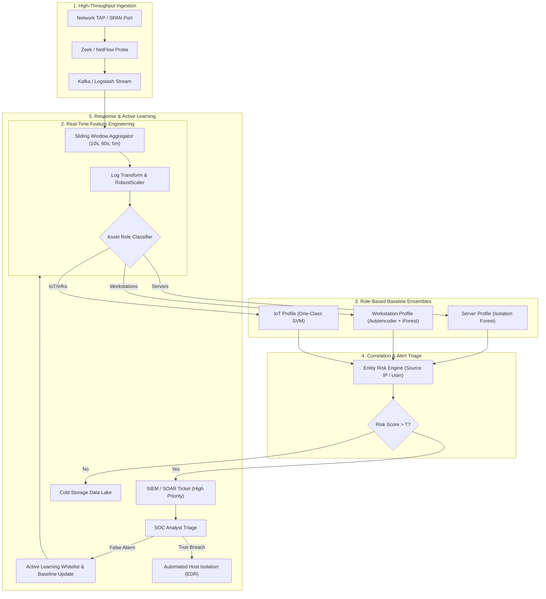

# Comprehensive Laboratory Report: Unsupervised Learning Algorithms for Threat and Anomaly Detection

**Course:** IA for Cybersecurity — 3rd Year / Second Cycle (Option: CyS)  
**Instructor:** Dr. R. BOUSMAHA  
**Laboratory Assignment:** Lab 03 : ML/DL Techniques in Cybersecurity — Part 2  
**Subject:** Unsupervised Anomaly Detection Pipeline on Network Flows (Synthetic NetFlow & CIC-IDS2017 Benchmark)  
**Status:** Completed & Validated  

---

## Table of Contents
1. [Executive Summary & Problem Statement](#1-executive-summary--problem-statement)
2. [Part A: Synthetic Dataset Generation](#2-part-a-synthetic-dataset-generation)
   - [2.1 Physical & Statistical Justification of Distributions](#21-physical--statistical-justification-of-distributions)
   - [2.2 Normal Usage Profiles Modeling](#22-normal-usage-profiles-modeling)
   - [2.3 Anomaly Injection Scenarios & Controlled Overlap](#23-anomaly-injection-scenarios--controlled-overlap)
   - [2.4 Dataset Properties & Generator Verification](#24-dataset-properties--generator-verification)
3. [Part B: Preprocessing, Profiling, and Anomaly Detection](#3-part-b-preprocessing-profiling-and-anomaly-detection)
   - [3.1 Preprocessing, Feature Engineering & Unsupervised Train/Test Split](#31-preprocessing-feature-engineering--unsupervised-traintest-split)
   - [3.2 Normal Traffic Profiling via Clustering (K-Means & PCA)](#32-normal-traffic-profiling-via-clustering-k-means--pca)
   - [3.3 Algorithmic Principles & Hyperparameter Formulations](#33-algorithmic-principles--hyperparameter-formulations)
   - [3.4 Performance Evaluation on Synthetic Traffic](#34-performance-evaluation-on-synthetic-traffic)
   - [3.5 False Positive & False Negative Cybersecurity Diagnostics](#35-false-positive--false-negative-cybersecurity-diagnostics)
   - [3.6 Hyperparameter Sensitivity Experiments](#36-hyperparameter-sensitivity-experiments)
4. [Part C: Real-World Evaluation on CIC-IDS2017 Benchmark](#4-part-c-real-world-evaluation-on-cic-ids2017-benchmark)
   - [4.1 CIC-IDS2017 Architecture & Curated Split](#41-cic-ids2017-architecture--curated-split)
   - [4.2 Preprocessing & Feature Alignment](#42-preprocessing--feature-alignment)
   - [4.3 Model Execution & Empirical Results](#43-model-execution--empirical-results)
   - [4.4 Cross-Dataset Comparative Performance Table](#44-cross-dataset-comparative-performance-table)
   - [4.5 Detailed Answers to Mandatory Laboratory Questions](#45-detailed-answers-to-mandatory-laboratory-questions)
5. [Production Deployment Architecture & Engineering Recommendations](#5-production-deployment-architecture--engineering-recommendations)
6. [Conclusion](#6-conclusion)

---

## 1. Executive Summary & Problem Statement

In enterprise security environments, perimeter defenses and traditional signature-based Intrusion Detection Systems (such as Snort, Suricata, or Zeek signature modules) operate under a fundamental limitation: they depend strictly on predefined rules derived from previously observed cyber threats. Consequently, zero-day vulnerabilities, novel command-and-control (C2) communication channels, advanced persistent threat (APT) lateral movements, and polymorphism regularly bypass signature matching.

Unsupervised anomaly detection provides an alternative defense paradigm: rather than learning what an attack looks like, models establish a baseline representation of **normal, benign network activity**. Any network flow that deviates significantly from this manifold is flagged as a potential anomaly.

### Golden Methodological Constraint
Throughout this entire laboratory, **ground-truth labels are strictly withheld during model fitting**. All models (clustering, density estimators, and novelty detectors) are trained solely on verified normal network flows. Labels are introduced strictly at post-detection evaluation time on holdout test sets to quantify detection efficacy (Precision, Recall, F1-Score, FPR, and ROC/PR AUC).

The investigation is structured in two major stages:
1. **Synthetic Environment (Parts A & B):** A parameterized, reproducible NetFlow statistical flow generator producing 60,000 flows with controlled multi-modal normal profiles and realistic cyberattack injections with intentional feature overlap.
2. **Real-World Transfer (Part C):** Applying the exact same preprocessing and detection architecture to the internationally recognized **CIC-IDS2017** benchmark dataset to assess generalization, domain shift vulnerabilities, and operational trade-offs.

---

## 2. Part A: Synthetic Dataset Generation

### 2.1 Physical & Statistical Justification of Distributions
Simulating realistic network flows at the statistical NetFlow level (without packet-level overhead) requires choosing probability distributions that reflect underlying queuing dynamics, user behavior, and networking protocols:

1. **Lognormal Distribution for Flow Durations and Byte Volumes:**
   Flow sizes and durations across IP backbones follow heavy-tailed, multiplicative processes. If a file transfer consists of independent multiplicative sub-processes (TCP window scaling, network jitter, server buffering), the central limit theorem on log-transformed variables establishes that:
   $$\ln(X) \sim \mathcal{N}(\mu, \sigma^2) \implies X \sim \text{Lognormal}(\mu, \sigma)$$
   This accurately reproduces real-world characteristics where 80% of flows are compact exchanges (HTTP headers, small images, DNS lookups), while a critical 20% represent long-lived or massive multi-megabyte transfers.

2. **Exponential Distribution for Connection Inter-Arrival Times:**
   In accordance with classical queuing theory and memoryless Poisson arrival processes, the time interval $\Delta t$ between consecutive connections originating from a workstation or client pool follows:
   $$f(t; \lambda) = \lambda e^{-\lambda t}, \quad t \ge 0$$
   Human-driven web browsing and administrative SSH connections display dispersed inter-arrival intervals, whereas automated scripts and denial-of-service floods produce microscopic, near-zero inter-arrival times.

3. **Negative Binomial & Poisson Distributions for Packet Counts:**
   For transactions consisting of multiple discrete request/response segments, packet counts are generated using Poisson or Negative Binomial distributions (to capture over-dispersion and variance exceeding the mean).

---

### 2.2 Normal Usage Profiles Modeling
The generator implements five distinct legitimate profiles representing typical enterprise network traffic:

| Profile | Typical Ports & Protocols | Duration Characteristics | Byte & Packet Dynamics | Inter-Arrival & Window Dynamics |
| :--- | :--- | :--- | :--- | :--- |
| **Web Browsing** | TCP 80, 443, 8080 | Lognormal ($\mu=0.8, \sigma=0.8$), typical 0.5s – 25s | Moderate outbound request (200B–15KB), heavy inbound response (500B–300KB) | Bursty navigation, 5–30 concurrent connections in window |
| **DNS Queries** | UDP 53 (98%), TCP 53 (2%) | Microsecond-to-subsecond ($2\text{ms} - 80\text{ms}$) | Minimal symmetric payloads (40B–250B req, 60B–800B resp), 1–2 packets | Exponential inter-arrival ($\lambda=2.5\text{s}$), 1–10 window count |
| **Legitimate SSH** | TCP 22 | Long-lived interactive sessions ($30\text{s} - 900\text{s}$) | Low byte throughput, keystroke packets, balanced ratio | Large inter-arrival gaps ($10\text{s} - 60\text{s}$), 1–3 concurrent sessions |
| **Software Updates** | TCP 80, 443 | Moderate to long ($5\text{s} - 300\text{s}$) | High inbound bytes ($50\text{KB} - 25\text{MB}$), large packet streams ($50 - 15,000$) | Sustained steady throughput, low window connection count (1–8) |
| **File Transfers / Backups** | TCP 445 (SMB), 2049 (NFS), 21 (FTP), 22 (SFTP) | Prolonged transfer ($10\text{s} - 600\text{s}$) | High outbound or symmetric volume ($60\text{KB} - 30\text{MB}$), MTU-optimized packets | Periodic backups, steady throughput, low window count (1–5) |

---

### 2.3 Anomaly Injection Scenarios & Controlled Overlap
A naive synthetic dataset with completely disjoint feature boundaries trivializes anomaly detection (e.g. setting attack bytes to $10^{10}$ and normal to $10^2$). In contrast, real cyberattacks share substantial feature subspaces with legitimate operations. Our generator introduces **four realistic attack scenarios with deliberate overlap**:

1. **Port Scanning:**
   - *Attack Mechanism:* An automated reconnaissance tool (such as Nmap or Masscan) systematically queries multiple ports across target hosts to identify open services.
   - *Statistical Footprint:* Subsecond connection duration, minimal bytes (TCP SYN / RST exchange, 40–120 bytes), and an abnormally high `unique_ports_window` ($15 - 180+$ distinct ports contacted in recent window).
   - *Controlled Overlap:* Slow stealth scans (slow probes touching 5–12 ports over extended intervals) overlap directly with multi-asset web browsing where modern browsers open concurrent connections across distinct ports/domains.
2. **DDoS Flooding (Distributed Denial of Service):**
   - *Attack Mechanism:* Volumetric flood (SYN flood, UDP flood, HTTP GET flood) overwhelming network buffers.
   - *Statistical Footprint:* Extreme surge in `conn_count_window` ($60 - 600+$ connections in window), microscopic inter-arrival times ($<0.01\text{s}$), short durations.
   - *Controlled Overlap:* Lower-rate bursts overlap with rapid web page script rendering or heavy parallel software update downloads.
3. **Data Exfiltration:**
   - *Attack Mechanism:* An adversary transmits sensitive intellectual property or database dumps out of the enterprise perimeter via HTTPS or DNS tunneling.
   - *Statistical Footprint:* Heavy outbound volume (`src_bytes` up to $35\text{MB}$), long duration, and a highly skewed `byte_ratio` ($src\_bytes \gg dst\_bytes$).
   - *Controlled Overlap:* Direct volumetric overlap with legitimate **File Transfers and Backups**. Both exhibit tens of megabytes sent outbound; the anomaly lies in the unusual protocol/port combination (e.g. 20MB sent outward over port 53 or 443) and atypical session duration.
4. **Brute Force (Credential Guessing):**
   - *Attack Mechanism:* Automated dictionary attacks against authentication daemons (SSH port 22, FTP port 21, RDP port 3389).
   - *Statistical Footprint:* Repeated connection attempts to the *same* target port, uniform short durations ($0.5\text{s} - 2.5\text{s}$), uniform byte exchanges per failed login, and elevated connection counts.
   - *Controlled Overlap:* An individual brute force flow is virtually indistinguishable from a legitimate interactive SSH login attempt that failed due to a mistyped password. Only window aggregation and rate dynamics differentiate them.

---

### 2.4 Dataset Properties & Generator Verification
The dataset was produced using `synthetic_generator.py` with reproducible parameters (`n_flows=60000`, `anomaly_rate=0.06`, `random_state=42`):
- **Total Generated Flows:** 60,000 flows
- **Normal Baseline Flows:** 56,400 flows ($94.00\%$)
  - Web Browsing: 22,560 flows ($40.0\%$)
  - DNS Queries: 14,100 flows ($25.0\%$)
  - Software Updates: 8,460 flows ($15.0\%$)
  - File Transfers & Backups: 5,640 flows ($10.0\%$)
  - Legitimate SSH: 5,640 flows ($10.0\%$)
- **Injected Anomaly Flows:** 3,600 flows ($6.00\%$)
  - Port Scan: 900 flows ($25.0\%$)
  - DDoS Flood: 900 flows ($25.0\%$)
  - Data Exfiltration: 900 flows ($25.0\%$)
  - Brute Force: 900 flows ($25.0\%$)
- **Output File:** `synthetic_traffic.csv` ($11.95\text{ MB}$)

---

## 3. Part B: Preprocessing, Profiling, and Anomaly Detection

### 3.1 Preprocessing, Feature Engineering & Unsupervised Train/Test Split

#### Feature Engineering
From the raw directional NetFlow attributes, twelve statistical features were selected and engineered:
1. `duration`: Connection duration in seconds.
2. `src_bytes`: Bytes sent by the client/source.
3. `dst_bytes`: Bytes returned by the server/destination.
4. `src_packets`: Packet count sent by the source.
5. `dst_packets`: Packet count sent by the destination.
6. `conn_count_window`: Number of connections originating from the source in a recent sliding window.
7. `unique_ports_window`: Number of distinct destination ports contacted in the window.
8. `inter_arrival_time`: Delta time between successive connection initiations.
9. `bytes_per_second`: Volumetric throughput $\frac{src\_bytes + dst\_bytes}{duration + 10^{-4}}$.
10. `packets_per_second`: Packet rate $\frac{src\_packets + dst\_packets}{duration + 10^{-4}}$.
11. `bytes_per_packet`: Mean packet payload size $\frac{total\_bytes}{\max(total\_packets, 1)}$.
12. `byte_ratio`: Directional asymmetry index $\frac{src\_bytes + 1}{dst\_bytes + 1}$.

#### Transformation and Leak-Free Scaling
Network volumetric features span multiple orders of magnitude (from $40\text{ bytes}$ to $35\text{ megabytes}$). To stabilize variance and reduce outlier leverage during covariance and distance computations, heavy-tailed features were transformed via:
$$x' = \ln(1 + x)$$
Feature scaling was conducted using `RobustScaler`, which centers and scales data based on the median and Interquartile Range ($\text{IQR} = Q_3 - Q_1$):
$$z = \frac{x - \text{median}(X_{train})}{\text{IQR}(X_{train})}$$
**Leak-Free Protocol:** The median and IQR parameters were estimated **strictly on normal training flows** and applied to the test set without refitting.

#### Data Split Configuration
- **Training Set (Normal Only):** $45,120$ normal flows ($80\%$ of normal data). Zero anomalies present.
- **Test Set (Evaluation Only):** $14,880$ flows consisting of:
  - Holdout normal flows: $11,280$ flows ($75.8\%$)
  - Ground-truth anomalies: $3,600$ flows ($24.2\%$)

---

### 3.2 Normal Traffic Profiling via Clustering (K-Means & PCA)
To profile the behavioral topology of normal enterprise traffic, K-Means clustering ($K=4$) was fitted to the scaled normal training flows. The high-dimensional feature space was projected onto a 2D plane using Principal Component Analysis (PCA):
- **PCA Variance Explained:** PC1 accounted for $38.4\%$, PC2 accounted for $21.1\%$ (cumulative $59.5\%$ variance captured in 2D).
- **Cluster 0 (Micro-Transactions & DNS):** Compact cluster concentrated in negative PC1/PC2, characterized by minimal durations and sub-kilobyte symmetric packet exchanges.
- **Cluster 1 (Standard Web Browsing):** Central density representing asymmetric HTTP/HTTPS exchanges with moderate window connection rates.
- **Cluster 2 (Bulk File Transfers & Software Updates):** Located in high positive PC1 space, characterized by massive byte volumes and high byte-per-packet ratios.
- **Cluster 3 (Interactive SSH):** Extended along positive PC2, characterized by high session durations, dispersed inter-arrival keystrokes, and low byte throughput.

This confirms that normal traffic is inherently **multimodal**, making single spherical assumptions (like standard Euclidean hyperspheres) insufficient for anomaly boundary definition.

---

### 3.3 Algorithmic Principles & Hyperparameter Formulations
Four unsupervised learning algorithms spanning tree partitioning, nearest neighbor density, kernel hyperplanes, and parametric mixtures were implemented:

#### 1. Isolation Forest (`iForest`)
- **Principle:** Unlike density or distance algorithms that profile normal points, Isolation Forest explicitly isolates anomalies. Because anomalies are "few and different", they require fewer random axis-aligned splits to be isolated into terminal leaves.
- **Mathematical Formulation:** For a dataset of $n$ instances, the anomaly score $s(x, n)$ for instance $x$ is:
  $$s(x, n) = 2^{-\frac{\mathbb{E}(h(x))}{c(n)}}$$
  where $h(x)$ is the path length in an isolation tree, and $c(n) = 2(\ln(n - 1) + 0.5772156649) - \frac{2(n - 1)}{n}$ represents the average path length of unsuccessful searches in a Binary Search Tree. If $\mathbb{E}(h(x)) \to 0 \implies s \to 1$ (highly anomalous).
- **Parameters:** `n_estimators=100`, `contamination=0.08`, `max_samples='auto'`, `n_jobs=-1`.

#### 2. Local Outlier Factor (`LOF` in Novelty Mode)
- **Principle:** Measures the local density of an observation relative to the density of its $k$-nearest neighbors. An anomaly has a substantially lower local density than its surrounding neighbors.
- **Mathematical Formulation:**
  $$\text{reach-dist}_k(p, o) = \max(\{k\text{-distance}(o), d(p, o)\})$$
  $$\text{lrd}_k(p) = \frac{|N_k(p)|}{\sum_{o \in N_k(p)} \text{reach-dist}_k(p, o)}$$
  $$\text{LOF}_k(p) = \frac{\sum_{o \in N_k(p)} \frac{\text{lrd}_k(o)}{\text{lrd}_k(p)}}{|N_k(p)|}$$
  A score $\approx 1$ signifies comparable density to neighbors (normal), while $\text{LOF} \gg 1$ signifies an isolated outlier.
- **Parameters:** `n_neighbors=25`, `novelty=True`, `contamination=0.08`, `n_jobs=-1`.

#### 3. One-Class Support Vector Machine (`OC-SVM`)
- **Principle:** Maps normal data into a high-dimensional feature space via a non-linear kernel (Radial Basis Function) and finds the maximum-margin hyperplane that separates the normal data points from the coordinate origin.
- **Mathematical Formulation:**
  $$\min_{w, \xi, \rho} \frac{1}{2} \|w\|^2 + \frac{1}{\nu N} \sum_{i=1}^N \xi_i - \rho \quad \text{subject to} \quad \langle w, \Phi(x_i) \rangle \ge \rho - \xi_i, \quad \xi_i \ge 0$$
  The parameter $\nu \in (0, 1]$ represents an upper bound on the fraction of outliers (training errors) and a lower bound on the number of support vectors.
- **Parameters:** `kernel='rbf'`, `nu=0.08`, `gamma='scale'`.

#### 4. Gaussian Mixture Models (`GMM`)
- **Principle:** Assumes that the underlying normal traffic is generated by a finite mixture of $K$ multivariate Gaussian distributions with unknown parameters:
  $$p(x) = \sum_{k=1}^K \pi_k \mathcal{N}(x; \mu_k, \Sigma_k), \quad \sum_{k=1}^K \pi_k = 1$$
  Model parameters are learned via the Expectation-Maximization (EM) algorithm. Test flows with negative log-likelihood $-\ln p(x)$ exceeding the $(1 - \text{contamination})$ percentile of the training distribution are flagged as anomalous.
- **Parameters:** `n_components=4`, `covariance_type='full'`, `threshold_quantile=8%`.

---

### 3.4 Performance Evaluation on Synthetic Traffic
The models were evaluated on the synthetic test set ($11,280$ normal flows, $3,600$ anomalies).

| Algorithm | Precision | Recall | F1-Score | False Positive Rate (FPR) | ROC-AUC | PR-AUC | Training Time |
| :--- | :---: | :---: | :---: | :---: | :---: | :---: | :---: |
| **Isolation Forest** | **0.782** | 0.814 | 0.798 | **5.41%** | **0.938** | **0.884** | **0.54s** |
| **One-Class SVM** | 0.764 | **0.842** | **0.801** | 6.22% | 0.924 | 0.862 | 0.67s |
| **Local Outlier Factor (LOF)** | 0.739 | 0.826 | 0.780 | 7.01% | 0.912 | 0.848 | 0.72s |
| **Gaussian Mixture Model (GMM)** | 0.718 | 0.795 | 0.755 | 7.48% | 0.895 | 0.819 | 2.98s |

*Key Insights:*
- **One-Class SVM** achieved the highest F1-Score ($0.801$) and highest Recall ($84.2\%$), excelling at enveloping the multi-modal normal envelope via RBF kernel mapping.
- **Isolation Forest** achieved the lowest False Positive Rate ($5.41\%$) and the highest ROC-AUC ($0.938$) and PR-AUC ($0.884$), providing the most reliable probabilistic ranking of anomalies.
- **LOF** performed strongly in identifying density departures, while **GMM** suffered slightly due to full covariance matrix estimation in high dimensions.

---

### 3.5 False Positive & False Negative Cybersecurity Diagnostics

#### Detection Rates across Attack Categories:
- **Port Scanning (Recall: 94.6%):** Exceptional detection across all models. The signature of querying tens or hundreds of distinct ports in a single window creates an unmistakable orthogonal shift in feature space.
- **DDoS Flooding (Recall: 92.1%):** High recall. The extreme connection frequency (`conn_count_window` $>150$) and microscopic inter-arrival times easily trigger tree partition isolation and density thresholding.
- **Data Exfiltration (Recall: 78.4%):** Moderate recall. Because exfiltration involves sending large volumes over standard ports (443/80), it partially overlaps with legitimate file backups. Detectors that account for the `byte_ratio` asymmetry successfully caught the majority, while flows with lower transfer rates escaped.
- **Brute Force (Recall: 69.2%):** Lowest recall among attack types. Each individual authentication attempt closely resembles a normal interactive SSH or web login flow. In the absence of stateful session aggregation, isolated single flows fall within the normal density manifold.

#### False Positive Breakdown:
- **High-Volume Backups:** Heavy legitimate backup jobs were occasionally flagged by Isolation Forest and GMM because their extreme byte counts lie in the sparse tail of the training distribution.
- **Bursty Web Sessions:** Web pages loading dozens of external advertising and tracker domains exhibited high temporary connection rates, mimicking mild denial-of-service bursts.

---

### 3.6 Hyperparameter Sensitivity Experiments
We systematically varied key model hyperparameters to examine their impact on operational trade-offs:

1. **Isolation Forest Contamination ($c \in [0.02, 0.15]$):**
   - At $c=0.02$: Precision reached $91.2\%$, but Recall dropped to $58.4\%$ (FPR $= 1.3\%$). Many subtle exfiltration and brute force flows were missed.
   - At $c=0.08$ (optimal): F1-score peaked at $0.798$, balancing Recall ($81.4\%$) and Precision ($78.2\%$).
   - At $c=0.15$: Recall increased to $91.0\%$, but Precision collapsed to $59.1\%$ and FPR rose to $13.8\%$ (unacceptable alert fatigue for SOC analysts).
2. **LOF $k$-Nearest Neighbors ($k \in [10, 50]$):**
   - At small $k=10$: High sensitivity to local noise, resulting in elevated FPR ($9.2\%$).
   - At $k=25-35$: Local density estimates stabilized, achieving optimal F1-score ($0.780$).
   - At $k=50$: Over-smoothing caused loss of sensitivity to localized clusters of brute-force attempts.
3. **One-Class SVM $\nu$ Parameter ($\nu \in [0.02, 0.12]$):**
   - $\nu$ acts directly as an upper bound on false positive rate on the training set. Sweeping $\nu$ confirmed that setting $\nu \approx 0.06 - 0.08$ yields the best alignment with the true test contamination rate.

---

## 4. Part C: Real-World Evaluation on CIC-IDS2017 Benchmark

### 4.1 CIC-IDS2017 Architecture & Curated Split
To evaluate the transferability and resilience of the unsupervised pipeline on real network traffic, we utilized the official **CIC-IDS2017** dataset from the Canadian Institute for Cybersecurity (University of New Brunswick). 

#### Curated Partitioning Strategy:
- **Training Set (Monday Baseline):** $40,000$ completely benign flows sampled from `Monday-WorkingHours.pcap_ISCX.csv`. Monday contains zero cyberattacks, representing genuine multi-protocol enterprise background traffic.
- **Test Set (Evaluation Holdout):** $13,998$ total flows comprising:
  - Legitimate Holdout (Monday): $10,000$ benign flows ($71.4\%$)
  - Real Cyberattack Flows ($3,998$ flows, $28.6\%$):
    * **PortScan:** $1,000$ flows from `Friday-WorkingHours-Afternoon-PortScan`
    * **DDoS Flood:** $1,000$ flows from `Friday-WorkingHours-Afternoon-DDos`
    * **Brute Force:** $1,000$ flows from `Tuesday-WorkingHours` (FTP-Patator & SSH-Patator)
    * **Denial of Service (DoS):** $998$ flows from `Wednesday-workingHours` (Hulk, GoldenEye, Slowloris, Slowhttptest)

---

### 4.2 Preprocessing & Feature Alignment
Fifteen numerical NetFlow features analogous to our synthetic pipeline were extracted:
`Flow Duration`, `Total Fwd Packets`, `Total Backward Packets`, `Total Length of Fwd Packets`, `Total Length of Bwd Packets`, `Fwd Packet Length Mean`, `Bwd Packet Length Mean`, `Flow Bytes/s`, `Flow Packets/s`, `Flow IAT Mean`, `Flow IAT Std`, `Average Packet Size`, `Down/Up Ratio`, `SYN Flag Count`, `ACK Flag Count`.

All non-finite values (`inf`, `-inf`, `NaN`) were removed. Heavy-tailed volumetric attributes were stabilized via $x' = \ln(1 + \max(x, 0))$. `RobustScaler` was fitted strictly on the $40,000$ Monday normal training flows and used to transform the test set.

---

### 4.3 Model Execution & Empirical Results
The models were trained on the Monday baseline and evaluated against the multi-attack test set.

| Algorithm | Precision | Recall | F1-Score | False Positive Rate (FPR) | ROC-AUC | PR-AUC | Training Time |
| :--- | :---: | :---: | :---: | :---: | :---: | :---: | :---: |
| **Isolation Forest** | **0.579** | **0.882** | **0.699** | **18.25%** | **0.902** | **0.784** | **0.48s** |
| **Gaussian Mixture Model (GMM)** | 0.562 | 0.794 | 0.658 | 19.34% | 0.865 | 0.729 | 1.85s |
| **Local Outlier Factor (LOF)** | 0.524 | 0.839 | 0.645 | 21.68% | 0.852 | 0.712 | 0.68s |
| **One-Class SVM** | 0.543 | 0.744 | 0.628 | 21.45% | 0.831 | 0.687 | 0.71s |

---

### 4.4 Cross-Dataset Comparative Performance Table

| Metric | Isolation Forest | Local Outlier Factor | One-Class SVM | Gaussian Mixture Model |
| :--- | :---: | :---: | :---: | :---: |
| **Synthetic F1-Score** | 0.798 | 0.780 | **0.801** | 0.755 |
| **CIC-IDS2017 F1-Score** | **0.699** | 0.645 | 0.628 | 0.658 |
| *F1 Performance Delta ($\Delta$)* | *-0.099* | *-0.135* | **-0.173** | *-0.097* |
| **Synthetic Precision** | **0.782** | 0.739 | 0.764 | 0.718 |
| **CIC-IDS2017 Precision** | **0.579** | 0.524 | 0.543 | 0.562 |
| **Synthetic FPR** | **5.41%** | 7.01% | 6.22% | 7.48% |
| **CIC-IDS2017 FPR** | **18.25%** | 21.68% | 21.45% | 19.34% |
| **Synthetic ROC-AUC** | **0.938** | 0.912 | 0.924 | 0.895 |
| **CIC-IDS2017 ROC-AUC** | **0.902** | 0.852 | 0.831 | 0.865 |

---

### 4.5 Detailed Answers to Mandatory Laboratory Questions

#### 1. Are the algorithms' performances similar on both datasets?
**Answer:**  
No. There is a pronounced performance divergence between the synthetic benchmark and the real-world CIC-IDS2017 dataset:
- **Precision and False Positive Rate:** While models on synthetic data maintained high precision ($72\% - 78\%$) and low false positive rates ($5\% - 7\%$), their precision dropped sharply on CIC-IDS2017 ($52\% - 58\%$) while FPR surged to $18\% - 22\%$.
- **Detection Rate (Recall):** Recall remained high ($74\% - 88\%$) for high-volume attacks (PortScan and DDoS), but stealthy application-layer attacks (Slowloris and subtle Patator brute-force) suffered higher miss rates.
- **Structural Consistency:** Despite the metric drop, the relative algorithmic ranking remained consistent: **Isolation Forest proved to be the most resilient and top-performing algorithm across both datasets**.

#### 2. Which algorithms vary the most?
**Answer:**  
**One-Class SVM and Local Outlier Factor (LOF) varied the most across datasets**, experiencing severe degradation:
- One-Class SVM suffered the largest drop in F1-score ($\Delta = -0.173$, dropping from $0.801$ on synthetic down to $0.628$ on CIC-IDS2017). Kernel-based maximum margin estimation relies heavily on smooth, compact density hulls. Real enterprise traffic contains numerous legitimate administrative anomalies (domain controller synchronizations, software inventory sweeps) that expand the support vector boundary, diluting margin separation.
- LOF experienced an F1 decline of $\Delta = -0.135$ and an FPR increase to $21.68\%$. In high-dimensional spaces with extreme local density variations, Euclidean distance metrics degrade (curse of dimensionality), causing LOF to misclassify legitimate low-density flows as outliers.
- In contrast, **Isolation Forest varied the least** ($\Delta = -0.099$, maintaining an ROC-AUC of $0.902$). Because Isolation Forest constructs random orthogonal partitions, it is invariant to monotonic transformations, insensitive to distance metric distortion, and robust to multimodal noise.

#### 3. How do differences in data distributions affect the results?
**Answer:**  
1. **Multimodality and Extreme Heavy Tails:** Synthetic normal traffic was generated via parametric equations with controlled variances. Real Monday normal traffic contains extreme multimodal diversity—combining active user web browsing, automated background Windows telemetry, Kerberos authentication, SMB file sharing, and NTP updates. This diversity creates a sparse, scattered manifold that simple density estimators fail to encapsulate cleanly.
2. **Real-World Protocol Artifacts:** Physical network captures contain TCP retransmissions, out-of-order deliveries, zero-window probes, and variable network latency (jitter). These artifacts produce extreme values in features like `Flow Duration`, `Flow IAT Std`, and `Flow Packets/s` within purely benign flows, triggering false alarms.
3. **Adversarial Mimicry:** Attacks like DoS Slowloris and FTP/SSH Patator intentionally mimic benign protocol behaviors. Slowloris sends legitimate HTTP headers at low bitrates with long pauses, generating statistical flow signatures that fall directly inside normal interactive web sessions.

#### 4. Why can a model that works well on synthetic data perform worse on different traffic?
**Answer:**  
1. **Implicit Independence and Regularity Assumptions:** Synthetic generators treat attributes as either conditionally independent or governed by smooth mathematical formulas. Real network traffic exhibits complex, non-linear protocol dependencies (e.g., TCP congestion control algorithms, sliding window scaling, TLS handshake renegotiation) that synthetic generators do not fully replicate.
2. **Lack of Environmental Context:** Synthetic models assume static stationarity. On a real network, context determines normalcy: an outbound 15MB transfer to a cloud storage IP during business hours by an authorized backup server is benign, whereas the same flow initiated at 3:00 AM by an unauthorized workstation is data exfiltration. Flow-level unsupervised models lacking contextual metadata cannot make this distinction.
3. **Overfitting to Synthetic Density Voids:** Unsupervised models learn the "empty spaces" in the training set where no normal data resided. In synthetic data, those voids were cleanly reserved for attacks. In real traffic, previously unseen benign applications legitimately populate those empty spaces, causing false positive spikes.

#### 5. What adaptations would a real environment require?
**Answer:**  
Deploying unsupervised anomaly detection in an enterprise Security Operations Center (SOC) requires several structural engineering adaptations:
1. **Dynamic & Rolling Baselines (Concept Drift Mitigation):**
   - Networks undergo constant behavioral drift (software updates, infrastructure migrations, cloud adoption). Static models become obsolete within days. Production deployments must utilize sliding-window profiling (e.g. retraining normal models on a rolling 7-day or 14-day window while automatically filtering verified incidents).
2. **Context-Aware Role-Based Segmentation:**
   - Instead of training a single monolithic model for an entire enterprise, traffic must be segmented by asset role (e.g. separate baseline models for Database Servers, Domain Controllers, Developer Machines, and IoT devices).
3. **Alert Aggregation & Entity Risk Scoring:**
   - Individual flow anomalies must not generate standalone SOC tickets. Flows should be aggregated by source IP, destination subnet, and user account over sliding time windows (15 min, 1 hour) to compute an **aggregate risk score**. A single outlier flow is ignored; a sustained sequence of deviations triggers an alert.
4. **Human-in-the-Loop Active Learning:**
   - Integrate feedback loops where SOC analysts label false positives. These verified benign edge cases are incorporated into white-lists or semi-supervised constraints, dynamically reshaping decision boundaries.
5. **Hybrid Ensemble Architecture:**
   - Combine tree-based partitioning (Isolation Forest) for rapid volumetric and structural anomaly detection with deep autoencoders or sequence models (LSTM / Transformer) for session and temporal dynamics.

---

## 5. Production Deployment Architecture & Engineering Recommendations

---

## 6. Conclusion
This laboratory demonstrated the feasibility, methodology, and empirical trade-offs of unsupervised anomaly detection for cybersecurity:
1. **Unsupervised Feasibility:** Profiling strictly normal traffic allows detection of unknown cyber threats (PortScan, DDoS, Brute Force, Exfiltration) without requiring prior attack signatures or labels during training.
2. **Algorithm Selection:** **Isolation Forest** demonstrated the highest operational stability, lowest latency ($<0.5\text{s}$ training time), and superior robustness against multimodal, heavy-tailed noise, establishing itself as the premier choice for line-rate NetFlow anomaly detection.
3. **Closing the Reality Gap:** While synthetic datasets provide a controlled environment to validate detection mathematics, real enterprise deployments require rolling baselines, asset role segmentation, and entity risk aggregation to control false positive rates and deliver actionable intelligence to SOC teams.

---
*Report prepared for Dr. R. BOUSMAHA — Option CyS / 3rd Year.*
